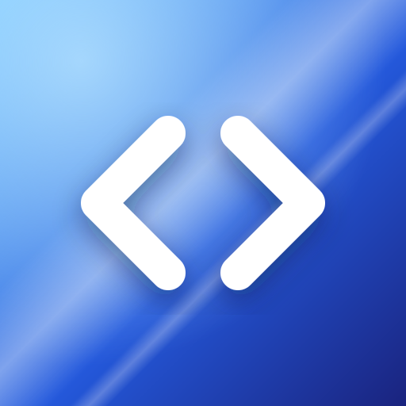
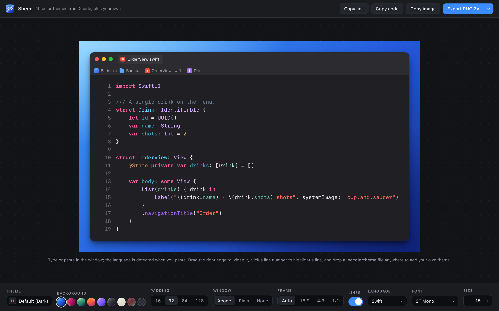
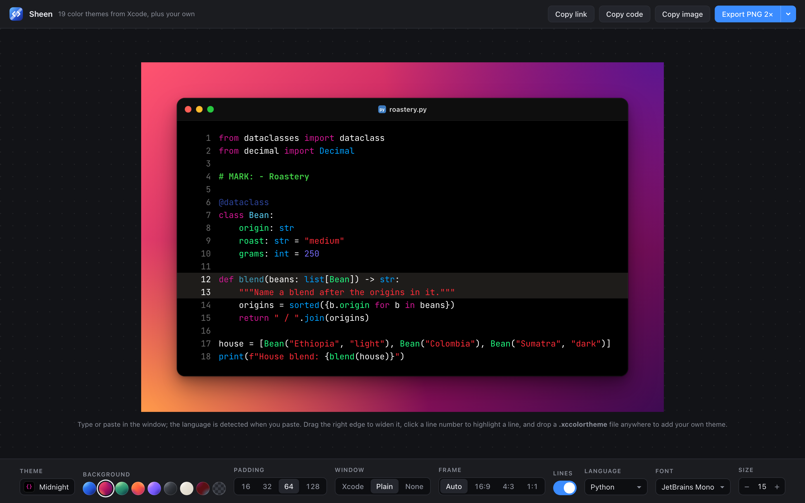
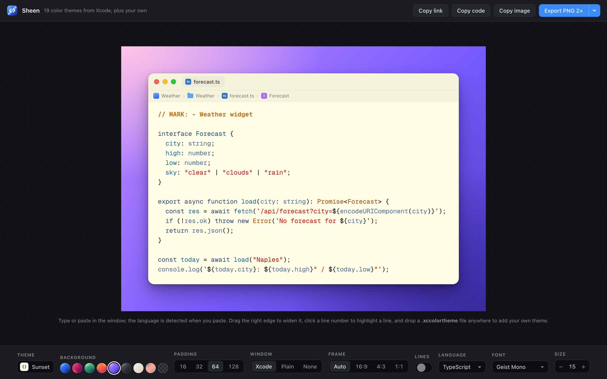

<p align="center">
  
</p>

<h1 align="center">Sheen</h1>

<p align="center">
  Beautiful code images in the color themes that ship with Xcode.<br>
  Self-hosted, offline, and one click away on umbrelOS.
</p>

<p align="center">
  <a href="https://github.com/Maltob03/sheen/actions/workflows/ci.yml"></a>
  <a href="LICENSE"></a>
  
</p>



## Features

- **All 19 Xcode themes, with Xcode's real colors.** Default, Classic, Presentation, High Contrast, Civic, Dusk, Midnight, Sunset, Low Key, Spartan and the rest, read straight from the `.xccolortheme` files inside Xcode.
- **Colored the way Xcode colors.** Types and functions you declare in the snippet get Xcode's *project* colors, everything else gets the *system* colors. `// MARK:`, `///` doc comments, `@State` attributes and `#Preview` macros look the way they do in Xcode.
- **Your own themes.** Drop any `.xccolortheme` file on the page to add it.
- **Crisp exports.** PNG at 1× to 4× and real vector SVG, drawn natively rather than screenshotted. SVGs embed the fonts they use.
- **Window styles.** An Xcode window with tab and path bar (editable file and project names), a plain macOS window, or no chrome at all.
- **Frames for posting.** Auto, 16:9, 4:3 or 1:1, nine backgrounds including a tint taken from the theme, and a handle to widen the window.
- **Five code fonts.** SF Mono from your system, plus JetBrains Mono, Geist Mono, IBM Plex Mono and Fira Code bundled, so images look right on any OS.
- **20 languages.** Swift, Objective-C, C, C++, Python, TypeScript, JavaScript, Kotlin, Java, Rust, Go and more, detected automatically when you paste.
- **Share links.** Copy a link that reopens the exact snippet and settings, imported theme included. The snippet lives in the link; nothing is stored on the server.
- **Private and offline.** No analytics and no outside requests: highlight.js and the fonts are bundled, and the page can be installed as an app.

| | |
| --- | --- |
|  |  |

## Install on umbrelOS

1. Open the **App Store** on your Umbrel.
2. Click **⋯** in the top right, then **Community App Stores**.
3. Paste `https://github.com/Maltob03/sheen` and click **Add**.
4. Open **Maltob App Store** and install **Sheen**.

Sheen opens at `http://umbrel.local:8473`, behind your Umbrel login, with its icon on the home screen.

## Run with Docker

```bash
docker run -d --name sheen -p 8473:8080 --restart unless-stopped ghcr.io/maltob03/sheen:latest
```

Then open http://localhost:8473. Images are published for `linux/amd64` and `linux/arm64`.

Or with Compose, using the [`docker-compose.yml`](docker-compose.yml) in this repo:

```bash
docker compose up -d
```

## Keyboard shortcuts

| Shortcut | Action |
| --- | --- |
| ⌘S / Ctrl+S | Export PNG |
| ⇧⌘C / Ctrl+Shift+C | Copy image |
| Tab / Shift+Tab | Indent / outdent |
| Double-click the window's right edge | Reset its width |

**Copy image** needs the page to be served over HTTPS (or `localhost`). On plain `http://umbrel.local`, use Export PNG.

## Develop

The whole app is one file, [`src/sheen.html`](src/sheen.html). It's written as a page body that loads highlight.js and the fonts from CDNs, so it can also run as a Claude artifact. [`src/build.py`](src/build.py) turns it into the self-hosted app in `app/`: a full document pointing at the bundled copies, plus the PWA manifest and service worker.

```bash
python3 src/build.py              # rebuild app/ after editing src/
python3 -m http.server 8473 -d app
```

CI fails if `app/` is out of date, so commit the rebuilt files together with your change.

| Path | What it is |
| --- | --- |
| `src/sheen.html` | The app: UI, Xcode theme data, highlighter, canvas and SVG renderer |
| `src/build.py` | Builds `app/` for self-hosting |
| `src/extract_themes.py` | Re-reads the themes from your installed Xcode |
| `src/sw.template.js` | Service worker template |
| `app/` | What the container serves |
| `nginx/` | nginx config: caching, gzip, a strict Content-Security-Policy, `/healthz` |
| `umbrel-app-store.yml`, `maltob-sheen/` | The umbrelOS community app store |

### Updating the Xcode themes

On a Mac with Xcode installed:

```bash
python3 src/extract_themes.py > themes.json
```

Paste the output over `XCODE_THEMES` in `src/sheen.html`, then rebuild.

### Releasing

1. Bump `VERSION` in `src/build.py`, run it, and add the release to [`CHANGELOG.md`](CHANGELOG.md).
2. Commit, then push a tag such as `v1.1.0`. The **Publish** workflow builds the multi-arch image, pushes `ghcr.io/maltob03/sheen:1.1.0` and `:latest`, and creates the GitHub release with the image digest.
3. Bump `version` and `releaseNotes` in `maltob-sheen/umbrel-app.yml`, and set the image in `maltob-sheen/docker-compose.yml` to the new tag pinned to that digest (`ghcr.io/maltob03/sheen:1.1.0@sha256:…`). Push to `main`; Umbrel offers the update once the manifest version changes.

## Credits

- Syntax tokenizing by [highlight.js](https://highlightjs.org) (BSD-3-Clause).
- Fonts via [Fontsource](https://fontsource.org): JetBrains Mono, Geist Mono, IBM Plex Mono and Fira Code, all under the SIL Open Font License 1.1 (see `app/fonts/LICENSE-*.txt`).
- Inspired by [ray.so](https://ray.so).

Sheen isn't affiliated with or endorsed by Apple. Xcode and SF Mono are trademarks of Apple Inc. SF Mono is never bundled; it's used only when it's already installed on your device.

## License

[MIT](LICENSE) © 2026 Matteo Altobello
